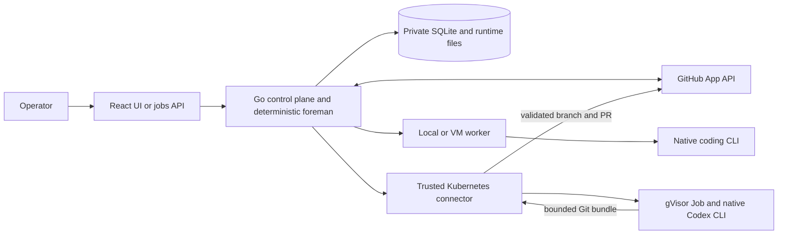

# Architecture

Machinist has one Go control plane, a React UI, and workers on a local host, VM,
or Kubernetes. It connects selected repositories through a GitHub App. The same
control plane can run locally, on a VM, or in the existing GKE runner cluster.
There is no required Machinist-hosted service.

## Product model

An **agent** is shared configuration and a Markdown role prompt, independent of
repositories. A **project** selects a connected repository and its checkout.
A **job** binds a request to a project and one fixed execution mode:

- `factory`: Triage → optional Spec and approval → Build → independent Review.
  Findings return to Build on the same branch and PR, for at most three repairs.
- `single`: one agent completes a task end to end, without a separate reviewer.

Each stage starts a fresh coding process. Triage and Review require restricted
read-only executors. An informational request can finish in Triage; requested
files, including documents and reports, require PR delivery. Spec approval is
bound to its producing attempt. Review acceptance is bound to the implementation
attempt and published head, not just a successful process exit.

The foreman is code that validates evidence and advances state. Conversational
Foreman chat, arbitrary workflow editing in the app, PostgreSQL, and replicated
control planes are not implemented. Lower-level direct commands and legacy
sequence workflows remain separate supported interfaces.

## State and authority

GitHub holds linked issues, published specifications, branches, PRs, checks, and
review discussions. A request does not need an issue. Linked issues receive one
readable status comment updated in place, with reconciliation after an uncertain
write. Internal prompts, logs, events, and handoffs are not posted to issues or
committed as deliverables.

Private SQLite `jobs.db` holds jobs, attempts, prompt versions and snapshots,
approvals, automation definitions, feedback, and completion receipts. It lives
beside the worker token, normally under `~/.machinist/server`. Credentials,
checkouts, logs, and worker outputs also belong to the private runtime. Back up
the whole runtime with a consistent SQLite snapshot. GitHub is not a backup of
execution state.

One process owns the database through a host lock. New submission receipts and
initial events commit atomically. Replaying the same `client_request_id` and
payload returns the existing job; changing the payload returns 409. Stale prompt
and automation edits are rejected. Running attempts retain their prompt snapshots.
Shared prompts are seeded once from legacy repository prompts, ordered by
repository name; existing shared edits take precedence.

On upgrade, the former `factory.db` is snapshotted into `jobs.db` and retired under
`archive/factory-v1.db`. IDs, events and hashed receipts survive. Legacy
`machinist.db` stores remain separate. Imported blocked jobs receive a publication
hold. Holds survive retries and prompt edits, prevent dispatch and GitHub updates,
and require an explicit release naming the current hold version. Stop running
work before changing publication access. A hold cannot undo an external write
already issued.

## GitHub and host execution

Onboarding uses a GitHub App's public client ID and device authorization. Access
is limited to the installation/user repository intersection; setup checks App
permissions and user write access. Tokens and refresh data stay private on the
control-plane host. Clients receive neither an App private key nor a shared
client secret. Refresh is serialized and preserves prior credentials on failure.

Local agent Git/gh processes receive a refreshed token through the environment.
The Git helper scopes normal Git authentication to the selected repository;
the API token can access other repositories granted to the App. VM workers use
their own host GitHub credentials. Local/VM workers are trusted with their host
account permissions: checkout selection is not an operating-system sandbox.
Executables, argument arrays, paths, models, and credentials are operator-owned.
Repository content cannot widen registered executor configuration.

Setup requires a real read-only PONG, plus repository and GitHub access checks.
Local workers start automatically. VM workers use a private pairing script and
an operator-created SSH tunnel. The app neither provisions SSH nor exposes a
public listener. Agents are shared across configured projects.

Project run-mode defaults and short instructions live in the existing atomic
onboarding settings file. The authenticated Projects editor changes only this
submission metadata, so running workers and job history are unaffected. New
interactive submissions resolve omitted choices from project defaults; explicit
choices win, and the admitted prompt stores the instructions used. Submission
receipts are checked before defaults so retrying a request preserves its job.
Projects do not override the shared agent or model configuration.

## Kubernetes execution

`internal/kuberunner` launches a fixed digest-pinned gVisor Job per attempt. Pods
are non-root, with a read-only root filesystem, dropped capabilities, bounded
resources, no host mounts, and no service-account token. Triage and Review source
is mounted read-only. An enforced NetworkPolicy permits cluster DNS and an
allowlisted HTTPS CONNECT proxy. Credential-free preparation verifies denial of
metadata, Kubernetes API, direct internet, and unapproved proxy destinations.

The agent receives a dedicated native Codex account cache, never GitHub, worker,
or cluster credentials. A ConfigMap lock serializes that account stream across
attempts and connectors. Native refresh is written back to the Secret using a
resource-version check. The CLI and code it runs can read the model credential;
this is trusted personal automation, not a shared subscription service.

The trusted connector imports a bounded returned Git bundle into a disposable
bare repository, validates head and ancestry, and publishes only the assigned
fast-forward branch and PR. It never runs candidate source in the publisher.
Publication checks the active lease and reconciles uncertain remote writes.

Cancellation asks the native process to stop, retains refreshed authentication
when possible, then foreground-deletes the Job. Unlock requires confirmed Pod
absence. Uncertain execution or cache persistence retains the lock for operator
recovery. There are no automatic Pod retries or local/API billing fallbacks.
See [runner setup and recovery](docs/local-factory/kubernetes.md).

The [GKE control plane](docs/local-factory/cloud-control-plane.md) uses one replica,
Recreate updates, and SQLite on a persistent disk. Its built-in dispatcher uses a
rotating in-cluster Kubernetes service-account token and narrow runner-namespace
RBAC. It needs no personal gcloud login at runtime. The UI stays on loopback,
accessed by operator port-forward; no public ingress is installed. Never run the
old laptop state and the cloud copy concurrently.

## Automations and GitHub follow-ups

Saved automations start single-agent jobs from the project root, manually or on
a five-field cron schedule with an IANA timezone. The control plane checks due
work every 15 seconds, coalesces missed occurrences, and prevents overlapping
unresolved jobs. Pausing prevents future scheduled admissions, not manual runs.

Repository maintenance is a distinct automation type. It gives a read-only agent
bounded issue/PR evidence and validates its recommendations. The foreman can
append existing classification labels without removing human or routing labels.
It never closes issues or PRs or posts internal reports to GitHub.

Only recorded factory PRs with an accepted independent review on the current head
can qualify for automatic merge. The fixed policy permits small edits to existing,
non-sensitive Markdown documentation. It also requires complete diff evidence,
a merge recommendation, successful current checks, strict protection for every
observed context, resolved conversations, and no outstanding change requests or
private hold. Fresh revalidation and a SHA-guarded asynchronous squash merge use
`bypass_rules: false`. Pending requests are not called merged. Single-agent and
unrelated PRs never qualify. The full policy is in [Automations](docs/local-factory/automations.md).

A separate poller checks up to ten PR-ready jobs per minute for qualifying CI
failures, trusted review feedback, and confirmed merges. It repairs the same PR
within the normal three-round limit and deduplicates consumed feedback. It does
not merge or resolve conversations. Only a confirmed merge with the recorded PR
head completes a delivery. See [GitHub follow-ups](docs/local-factory/github-followups.md).

## Failures and code boundaries

Transitions commit before dispatch or acknowledgement. Duplicate completions do
not advance twice. Restart interrupts running work instead of replaying external
side effects; retry requires proof the old process stopped. GitHub publication
failures preserve durable results and remain visible. Missing or incomplete
remote evidence fails closed.

- `internal/controlplane`: API, onboarding, SQLite jobs, deterministic foreman,
  schedules, maintenance policy, GitHub polling and status publication.
- `internal/managedworker`: allowlisted execution, workspaces, evidence,
  publication, leases, heartbeats and process lifecycle.
- `internal/runner`: bounded process execution, provider output and token reporting.
- `internal/kuberunner`: sandbox templates, proxy, authentication retention and cleanup.
- `internal/githubauth`: process-scoped Git credentials.

Automated checks cover state transitions, privacy, idempotency, authorization,
merge gates, cleanup and provider failure paths. Live GKE evidence is recorded
beside the relevant deployment guide; it does not prove every provider or failure
mode. Follow [Development](docs/development.md) for repeatable checks.

## Native agent runs

The versioned `native-v1` recipe owns one `primary` run. Claude uses streaming CLI
JSON; Codex owns one stdio app-server with account/model preflight. The harness
discovers repository child definitions in the task worktree. Children are observed
activities with native identities, not separately scheduled runs or leases.
Only primary messages and usage determine the outcome. Child failures can be
recovered by the primary.

Worker disk spools carry sequence IDs. Bounded lease-authenticated batches replay
idempotently into a separate SQLite activity stream, which the UI polls. Completion
flushes pending events. Existing lifecycle history, publication holds and PR
branch/head evidence checks remain intact. Native feedback queues another primary
attempt without legacy role routing or the three-repair limit. Existing maintenance
automations retain their enforced review policy.

Native runs currently require host workers and saved Codex repository trust. They
do not enforce the legacy spec gate or isolated read-only review checkout. The
server retains in-memory leases and honest interruption handling after restart.
See [native operation and checks](docs/native-agents.md).
