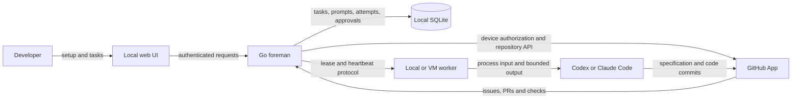

# Architecture

Machinist runs local agent jobs. The Standard pipeline uses Triage, optional Spec, Build and independent Review. Single-agent mode performs one task without a separate reviewer. Its agents
run through the user's Codex or Claude Code CLI on this computer or a VM. A
GitHub App connects selected repositories. No hosted agent service is required.

The browser configures the foreman. Workers execute on user-controlled hosts.
GitHub owns published work; the local database owns execution bookkeeping.

## Ownership and invariants

- INV-1: GitHub holds linked issues, published specs, branches, PRs, checks, and
  review. Local requests need no issue. A PING never creates one.
- INV-2: SQLite holds factory tasks, event history, prompt overrides, snapshots,
  approvals, and completion receipts. Internal events and prompts are never posted
  to issue comments. A linked issue gets one readable status comment, updated in
  place. After an uncertain write the next update reconciles its own marker first.
- INV-3: A GitHub App device authorization uses a public client ID. Credentials
  and refresh tokens stay in private local files. No shared client secret or App
  private key is distributed. API access is limited to the installation/user
  repository intersection. Setup checks both App permissions and user write access.
- INV-4: Local worker credentials are refreshed per run and supplied only through
  the process environment. A Git credential helper is scoped to github.com and
  the selected repository. Tokens never appear in Git URLs or command arguments.
  VM workers use credentials on the VM; ordinary pairing never sends the user's
  GitHub App token to that host.
- INV-5: The host owns executor argument arrays, repository paths, credentials,
  model configuration, and temporary worktrees. Repository content cannot widen
  that configuration. Review requires a configured read-only executor.
- INV-6: Setup completes only after repository checks and a real PONG from the
  selected agent. VM setup requires a matching worker handshake and a read-only
  connection check on the VM. The check makes no issue, commit, or PR.

## Components and data

`internal/controlplane` owns onboarding, scheduling, the local factory store,
GitHub connection, and readable status publication. `internal/managedworker`
owns allowlisted host execution, isolated worktrees, evidence checks, heartbeats,
and process lifecycle. `internal/runner` bounds and observes a single process.
The CLI injects the local worker launcher into the foreman, avoiding a package
cycle. `internal/githubauth` supplies process-scoped Git credential settings.

A task has a stable local identity, repository alias, requirements, optional issue
URL, stage attempts, prompt snapshots, and completion receipts. Receipt tokens
are hashed. A stage result advances the deterministic reducer. Database events
are internal implementation data, even where compatibility types retain older
GitHub-oriented names.

Jobs use one process-locked SQLite store, `jobs.db`, beside the configured worker token. The first launch snapshots the former `factory.db`, preserves IDs, events, prompts and hashed receipts, then retires it under `archive/factory-v1.db`. Existing blocked work receives an explicit publication hold. Worker outputs remain in place and must be included in runtime backups. Legacy direct/sequence `machinist.db` stores remain separate and unchanged. New submission receipts and initial recipe events are atomic, so repeating a client request ID returns the same job after response loss or restart. Reusing an ID for a different request fails.

Factory runtime data normally lives under
`~/.machinist/server`. Onboarding settings, credentials, temporary checks, and
managed checkouts live below that directory. They are not placed beside source
prompt definitions. Credentials use mode 0600 and their directory mode 0700.
Execution history must be backed up for recovery; GitHub comments are not a backup
of local scheduling state.

## Runtime flows

First launch opens setup: connect GitHub, choose a repository and checkout, choose
an agent and host, verify, then start work. Device authorization handles pending,
rate-limited, denied, and expired responses. Token refresh is serialized and a
failed refresh preserves the prior credentials. Repositories without required
permissions remain visible with an explanation.

For local execution the foreman starts an in-process managed worker. For a VM it
provides a private setup script and an SSH forwarding command. The displayed
forward is initiated on the VM toward the foreman's SSH host; that requires SSH
reachability to the foreman. The app never opens a public listener or enables SSH.
The VM keeps its own GitHub and provider authentication.

A job fixes its built-in mode at creation: `factory` for the Standard pipeline or `single` for one task runner. No arbitrary workflow is offered. Historical direct/answer jobs retain their recorded transitions for recovery but cannot be newly submitted. Triage and Review use restricted read-only executors with host-collected evidence. Standard delivery always starts at Triage, which requests Spec only for consequential decisions. Single-agent tasks may return an operational result directly; repository changes require verified PR delivery, with no independent review claimed. Both modes wait for human merge when a PR exists. Spec pushes
one tracked specification and draft PR, then pauses for approval of that attempt.
Implement reuses the branch and PR. Independent Review checks the exact published
head using bounded host-collected evidence. Findings trigger at most three repair
rounds. Accepted review waits for human merge and a verified GitHub merge check.
The factory never merges automatically.

Transitions and receipts are committed locally before dispatch or acknowledgement.
Restart interrupts running work rather than replaying side effects. Retry requires
confirmation that an interrupted process stopped. Prompt saves use optimistic
version checks. A failed readable status update does not erase a durable result.

## Compatibility and operating limits

`server.state = "factory"` selects this backend; `github` remains a compatibility
alias. Legacy direct and sequence modes keep their existing SQLite/artifact
contracts. Previous GitHub event comments remain historical and are not deleted
or treated as the active database. Re-adopt a linked issue explicitly to start a
new local task. There is no automatic migration of old comment journals.

A publication hold survives retries and prompt edits. Held jobs are never dispatched, and no status or label content is written to GitHub for them. A dedicated operator release action must name the current hold version. Running work must first be cancelled and stopped before changing publication access; already issued GitHub writes cannot be undone.

One foreman owns a local factory database. Multiple trusted workers can connect.
The UI uses a compact runs table and grouped sidebar. Inbox clearing is a durable
notification preference, not task deletion; later workflow activity resurfaces it.
Role prompts and embedded execution contracts use Markdown. PostgreSQL, a
conversational Foreman and versioned custom roles remain planned. The current
trusted local/VM compatibility worker still receives per-run GitHub credentials.

## Kubernetes execution

An optional Kubernetes connector runs beside the existing local control plane.
It uses an explicit kubectl context and a fixed, digest-pinned gVisor Job per
attempt. It sends Git objects and execution context, never host credentials or a
worker bearer. The agent receives a dedicated native Codex account cache and no
GitHub or cluster token. Triage/Review source is mounted read-only. An enforced
network boundary permits only cluster DNS and an allowlisted HTTPS CONNECT proxy;
credential-free preparation probes this before the agent starts.

A cluster lock serializes native auth-cache refresh. Completion retains the
refreshed Secret with a resource-version check. Cancellation requests native
shutdown, attempts cache retention, and deletes the Job in the foreground. Unlock
requires Pod absence. Uncertain execution/cache persistence keeps the lock and
requires operator recovery; jobs never retry themselves or fall back to local/API
execution. A restarted local control plane resumes its connector, not an old
attempt. Existing interrupted-attempt confirmation still applies.

For this target, the trusted connector validates bounded candidate bundles in a
bare repository and publishes the assigned fast-forward branch and PR. It never
runs candidate source in that publisher. Publication checks the active lease and
reconciles the assigned remote branch after a lost response. This retains the
existing single-owner local lease model; durable distributed leases, a separate
publication gateway and a cloud control plane remain future work. The database
and GitHub App connection do not move into agent Pods. See the
[Kubernetes runner guide](docs/local-factory/kubernetes.md).

Cross-machine foreman replication, hosted token relays, push webhooks, automatic
CI repair, merge polling, and live output streaming are not included.

Automated proof covers authorization failure paths, local restart and receipts,
zero GitHub writes for plain tasks, comment retry reconciliation, credential
scoping, VM health checks, and setup gating. Live GitHub consent is completed by
the account owner. See the [factory guide](docs/local-factory/README.md).
