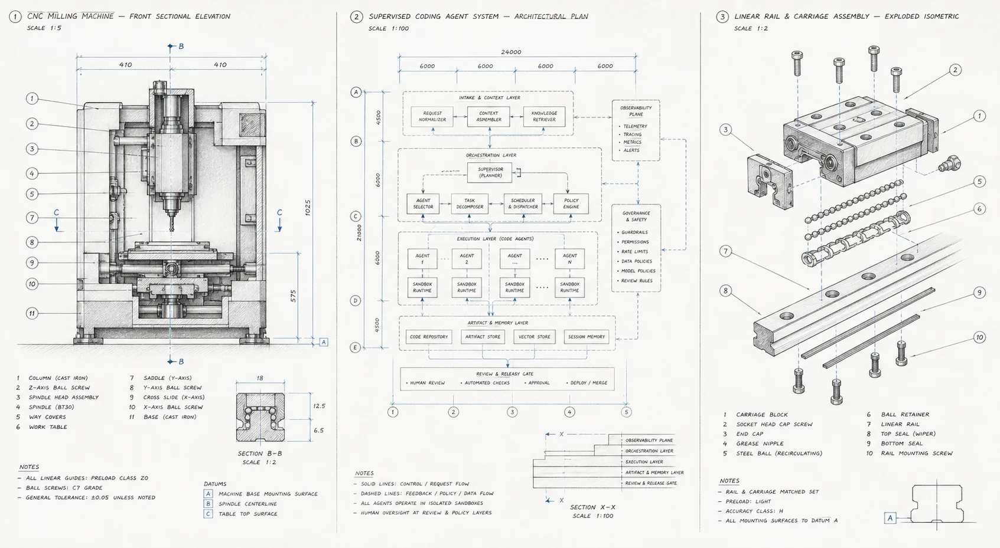

<p align="center">
  
</p>

<p align="center">
  <strong>The open source AI software factory for agentic coders.</strong><br>
 Machinist is an open source software factory for repeatable and scalable AI coding workflows. 
</p>

<p align="center">
  <a href="https://machinist.sh">Website</a> ·
  <a href="docs/README.md">Documentation</a> ·
  <a href="docs/configuration.md">Configuration</a> ·
  <a href="examples/workflows/README.md">Workflow examples</a>
</p>

<p align="center">
  
</p>

<p align="center"><sub>Machine section · supervised agent system · exploded assembly</sub></p>

Machinist is an open-source software factory implementation. It runs on your machine, keeps repository access and credentials local, and records the work from request to handoff. Commands can invoke Codex, Claude Code, another agent CLI, a test runner, a shell script, or repository-owned orchestration.

Please note: this is early access software and subject to change. 

## Why Machinist

- **One controlled entrypoint.** Workers expose named commands and repositories, never arbitrary shell text or machine-local paths.
- **Bring your own harness.** Use any executable that accepts a prompt on standard input.
- **Keep authority local.** Repositories, credentials, model aliases, and executor configuration stay on the worker.
- **Inspect every run.** Stream output, retain durable events and artifacts, and track terminal outcomes, duration, and reported token use.
- **Choose where to approve.** Pause before a step, review its files, and approve or request changes. Optional merge policies can automate narrowly defined low-risk changes.

<a id="quick-start"></a>

## Quick start

Build and initialize Machinist:

```sh
git clone https://github.com/owainlewis/machinist.git
cd machinist
mkdir -p ./bin && go build -o ./bin/machinist ./cmd/machinist
./bin/machinist init
```

`init` installs the four factory specialists plus direct `task-to-pr` and `audit` commands in `~/.machinist/config.toml`.
Each is a prompt, an executor, and a timeout:

```toml
# ~/.machinist/config.toml
[commands.task-to-pr]
executor = "codex"
prompt_file = "prompts/task-to-pr.md" # optional
timeout = "120m"
```

Run it directly:

```sh
./bin/machinist run --command=task-to-pr --repo=/path/to/repo --prompt="Complete https://github.com/owner/repo/issues/42"
```

For guided setup, run `./bin/machinist start` and open the printed local URL.
Connect GitHub, choose a repository and local or VM agent, then verify it with PING.
No TOML editing or GitHub issue is needed for the connection check. See the
[onboarding guide](docs/local-factory/README.md).

## Multiple projects

Open **Projects → Add project** to connect another repository. Adding a project
preserves your existing projects, agent, and execution target. Each repository
gets its own checkout, and runs and automations choose from the configured list.
The project list is saved on the control-plane host and restored after restart.

Only repositories granted to your GitHub App appear. Use **Manage GitHub access**
to grant more repositories, then **Refresh repositories**. Local and Kubernetes
runners reload while idle. For a VM, stop its existing worker, download the updated
VM setup from Projects, and run it to clone and register all configured projects.

## How execution works

For the four-specialist pipeline and its Warp-style Inbox, Runs, Agents, and
Automations UI, start with [the local factory guide](docs/local-factory/README.md).
Triage can skip Spec, specifications wait for approval, and independent review
findings return to the same implementation branch and pull request. Agents run
through your Codex or Claude Code executors on a local host or remote VM.

For a direct run, Machinist maps the configured command name to a fixed executable and uses the path supplied with `--repo` as the working directory. Managed submissions instead resolve an approved repository name from the worker configuration. In both cases, Machinist renders the prompt, sends it on standard input, streams stdout and stderr, and applies one overall timeout and cancellation. Exit code 0 succeeds; every non-zero exit code fails.

Inside each command, scripts are intentionally opaque. Their internal stages appear in logs, but Machinist does not infer their internal stages. A killed script restarts from the beginning unless the script owns checkpointing.

For explicit steps, [configure a workflow](docs/workflows.md):

```toml
[workflows.deliver]
steps = ["task-to-pr"]
```

Workflow tasks retain results and saved files, support approval and feedback, and keep earlier attempts in history. Each stage can read and write `{{task.output_dir}}`; Machinist restores and saves the shared folder between stages.

Start with [your first task workflow](docs/task-guide.md): create a task from an issue or spec, follow it on the board, and review the result. The [classify-then-merge example](examples/workflows/risk_delivery/README.md) adds independent risk assessment and a conservative merge policy.

## Go deeper

| Guide | What it covers |
| --- | --- |
| [Documentation](docs/README.md) | Choose the right setup and operations guide |
| [Task workflow guide](docs/task-guide.md) | Set up planning, approval, shared files, and build |
| [Configuration](docs/configuration.md) | Commands, executors, workers, models, and repositories |
| [Development](docs/development.md) | Build, test, and work on Machinist locally |
| [VM deployment](docs/vm-deployment.md) | Run the control plane and worker as services |
| [Workflow examples](examples/workflows/README.md) | Prompt-driven and scripted workflows |

## Contributing

Read [CONTRIBUTING.md](CONTRIBUTING.md) for development setup and pull-request expectations. Security issues should follow [SECURITY.md](SECURITY.md).

Machinist is released under the [MIT License](LICENSE).

### Local jobs

**New run** offers two modes. **Standard pipeline** runs Triage, optional Spec,
Build, independent Review, and human merge. **Single agent** runs one operational
task or automation without a separate reviewer. Requested repository changes
still use PR delivery and human merge; unchanged operational tasks return a result.
There is no custom workflow editor. The compact table includes stage progress dots.

API clients set `recipe` to `factory` or `single` and supply a stable
`client_request_id`. Repeating the same request after a lost response returns the
same job. A changed payload with that ID returns 409. Existing
`workflow: "factory"` submissions remain compatible.

On upgrade, the app snapshots `factory.db` into `jobs.db` and archives the old
store. Back up the full private runtime directory, including worker outputs.
Imported blocked jobs are held private until explicitly reviewed and released.
See [local job behavior](docs/local-factory/local-jobs.md).

### Kubernetes runners

Keep the control plane local or on a VM and run individual agent attempts in
gVisor Kubernetes Jobs. The first target supports a dedicated Codex subscription
login, serialized refresh, restricted egress and trusted GitHub PR publication.
See [Kubernetes setup and recovery](docs/local-factory/kubernetes.md).
